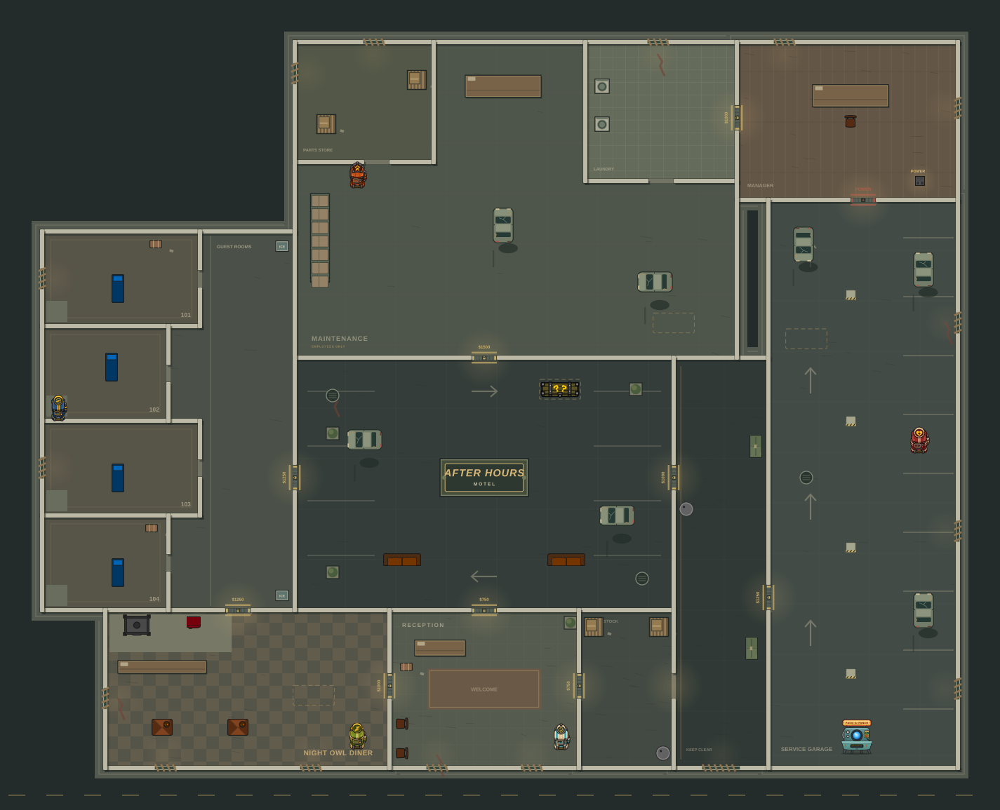

# After Hours (Zombie Survival `specops_complex`)

After Hours is a roadside motel and garage during a nighttime zombie outbreak.
The motor court replaces Last Call's nightclub-and-pool theme. Warm reception
lighting, worn guest rooms, a diner, maintenance rooms and a service garage
surround a parking courtyard with the **After Hours Motel** sign as its landmark.

The map keeps the existing purchase and power progression. Its internal map,
building, atlas, asset and `LastCall*` identifiers remain unchanged for
compatibility; player-facing names use After Hours.

## Layout and progression

The nine zones occupy a 217.5 × 172.5 block inside the existing 256 × 208 map:
reception (`lobby`), storage, motor court (`courtyard`), diner, service alley,
guest wing (`wing`), maintenance hall (`club`), manager's office and garage.

Reception offers three purchases: the motor court for 750, diner for 1000,
or storage for 750. Storage's open connection into the alley provides an
alternative approach to the courtyard and garage. The diner–guest-wing route
forms the west loop; maintenance, the office and the garage form the east loop
once the power gate opens. Gate prices and all power, perk, mystery-box,
Pack-a-Punch and wave rules are unchanged.

The guest rooms have alternating widths instead of identical boxes. The
maintenance hall contains smaller parts and laundry rooms with open doorways,
so its fighting space has corners and narrower approaches. These subdivisions
stay within their parent zone and add no purchases. Buy gates and service-room
doorways are 6 game units wide; guest-room doorways remain 4 units wide and
have no hinged doors to snag zombies.

Cars, the sign island, service fixtures and furniture break up long sightlines
without filling the central routes with clutter. The shared layout defines
solid props; decorative floor marks, oil, paper and blood do not block movement.

## Art and collision

`shared/defs/maps/lastCallLayout.ts` is the source of truth for zones, internal
rooms, doorways, windows, stations, props and zombie entries. The building
and art generator read the same scaled positions and wall segments.

The generated floor uses muted asphalt, worn concrete, faded paint, quiet
room textures and boarded windows. Gate thresholds, machine areas and zombie
entries remain legible. Painted fixtures have matching collision; separate
sprites cover cars, shutters, the power gate, pillars and dumpsters. The motel
sign's light flickers through a game decal rather than an animated SVG.

Zombies enter only through the windows and manholes of zones connected to a
living operator through opened gates. Internal room doorways use the same
portal navigation as the larger zone connections. The existing map-specific
navigation retains its 6-unit waypoint grid, body-clearance checks,
room-aware path cache and string-pulled movement.

## Files

| File | Purpose |
|------|---------|
| `shared/defs/maps/lastCallLayout.ts` | Layout, internal rooms, fixtures, doorways, entries and stations. Edit this first. |
| `shared/defs/lastCallObjectDefs.ts` | Generated wall collision, prop definitions, sign light and building. |
| `scripts/lastcall/buildArt.ts` | Deterministically generates the floor and prop SVGs. |
| `client/atlas-builder/defs/lastcall.ts` | Existing atlas and compatible asset names. |
| `server/src/game/lastCallNav.ts` | Open-zone traversal, doorway portals and body-clearance checks. |
| `tests/src/lastCall.test.ts` | Layout, collision, unopened-zone spawn and complete navigation checks. |
| `tests/src/zombieMode.test.ts` | Existing zombie rules, gate, power, perk and Pack-a-Punch regressions. |



`preview.png` is a composition of the generated floor and actual object sprites,
not a game screenshot. The delivered review files also include a live-client
capture.

## Editing and regeneration

Base-plan coordinates have x increasing rightward and y increasing downward.
`LastCallScale` is 1.5. Rooms and built-in fixtures scale with the plan;
furniture, cars, stations and mystery boxes keep their game size. Props close
to a wall keep their wall clearance when the plan scales. Door and window
widths remain fixed.

After moving walls or fixtures:

```sh
bun scripts/lastcall/buildArt.ts
cd tests
bun run test --run lastCall zombieMode
```

The tests exercise the generated game collision, rather than relying on the
floor image: every wall and spawn entry is checked, every opened doorway must
fit a zombie, and complete paths include their final approach into every zone,
from every entry, and to station and mystery-box interaction areas. Initial
waves must remain inside the unopened reception area. The zombie-mode suite
also checks that power opens the freight gate and enables Pack-a-Punch.

For a size change, keep `baseWidth`/`baseHeight` in `zombieIndoorDefs.ts` large
enough for the block and street apron, then update the map-size assertion in
`zombieMode.test.ts`. Floor raster density is shared through `LastCallFloorPixelsPerUnit` (24 /
`LastCallScale`), giving a 3800 × 3080 image at the authored scale. The floor
sprite applies the inverse density so world dimensions stay exact and the
texture fits the existing 4096-pixel atlas limit.
